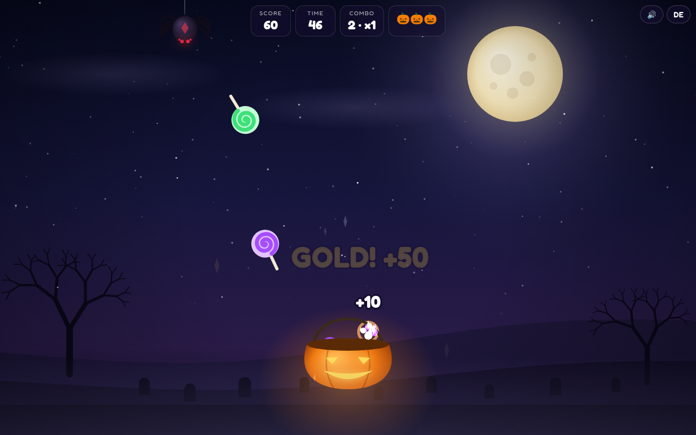

# 🎃 Candy Catch

A small moonlit Halloween browser game. Move the pumpkin basket, catch falling candy, grab golden bonuses and dodge the spiders.

**Play:** https://frank-otto.github.io/candy-catch/

## How to play (in 10 seconds)
- Move the basket with the **mouse**, by **touch** (tap or drag) or with **← →**.
- Every candy is points. **Golden candy** is worth 5× more.
- Catch candy in a row to build a **combo** (×2 … ×5 multiplier). A missed candy breaks it.
- **Spiders** cost one of 3 lives and break the combo.
- A round lasts **50 seconds** and the tempo rises every second.

Extras: English by default with a **DE** toggle, a **kids mode** (slower, no spiders), and a shareable **highscore card** (PNG, 1080×1350; the default name is "Player").

## Run locally
Open `index.html` directly (works from `file://`, no server needed). To rebuild after editing `src/`:
```
npm install && npm run build
```
This bundles `src/` with esbuild into one classic script (`js/game.bundle.js`) and embeds the sounds into `js/sounds-src.js`.

## Tests
`python3 test/test_game.py` (Playwright + Chrome, headless): load without console errors, catching, avoiding, golden bonus, end screen, PNG card size, DE toggle, kids mode, mobile tap.

## Credits
All sounds are recorded CC0 samples (see `LICENSES/SOUNDS.md`). Font: Fredoka (SIL Open Font License 1.1). Canvas 2D, no other runtime dependencies.


